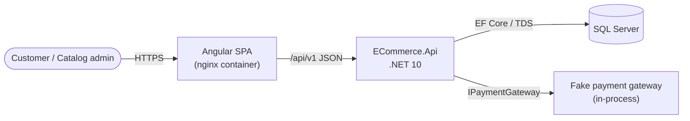
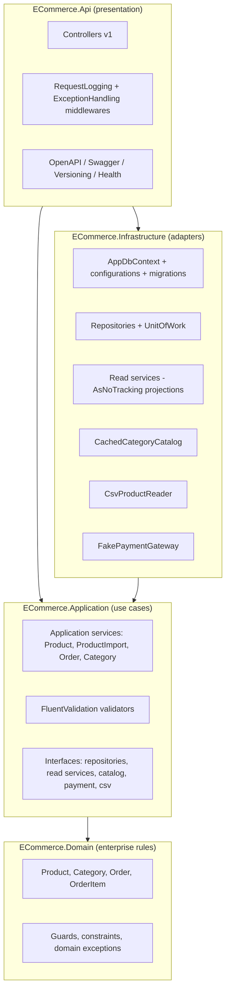
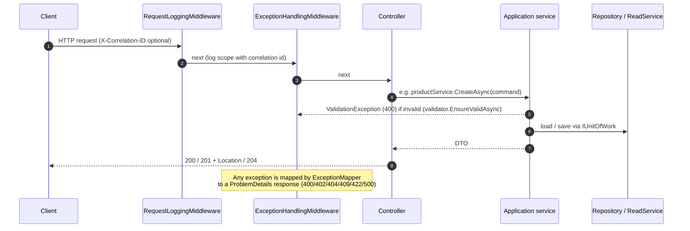
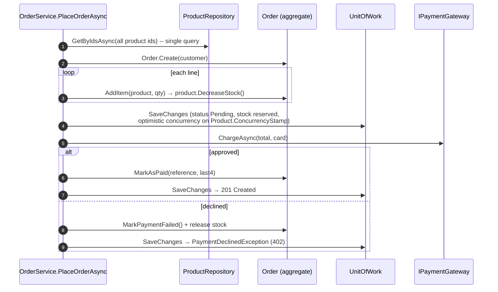
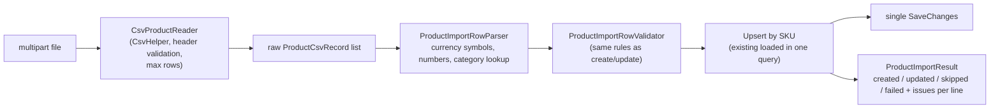
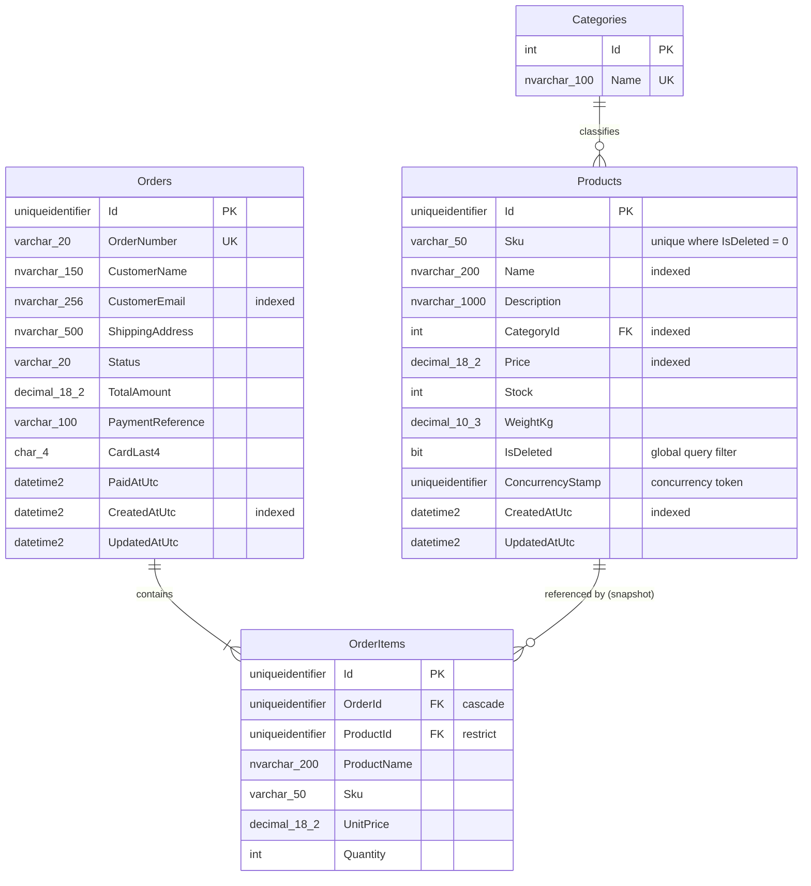
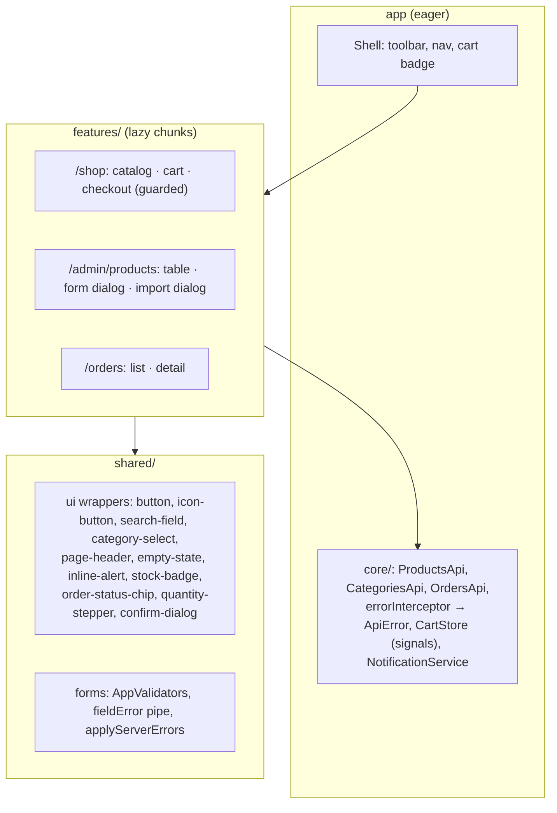

# Architecture

## 1. System context



| Container | Image | Port |
|---|---|---|
| `web` | `nginx:alpine` serving the Angular build; reverse-proxies `/api`, `/openapi`, `/swagger`, `/health` to `api` | 8081 → 80 |
| `api` | `mcr.microsoft.com/dotnet/aspnet:10.0`, non-root user | 8080 |
| `sqlserver` | `mcr.microsoft.com/mssql/server:2022-latest`, data in a named volume, health-checked | 1433 |

The API waits for the database health check, applies migrations, seeds data and then starts listening.

## 2. Backend — Clean Architecture



Dependencies point inward only. `Domain` references nothing. `Application` references only `Domain` and defines the ports it needs. `Infrastructure` implements those ports. `Api` composes everything in `Program.cs` through three extension methods: `AddApplication()`, `AddInfrastructure(configuration)` and `AddApi(configuration)`.

### Folder layout

```
backend/
├── src/
│   ├── ECommerce.Domain/
│   │   ├── Common/          Entity, AuditableEntity, Guard, IAggregateRoot, IConcurrencyAware
│   │   ├── Categories/      Category, CategoryConstraints
│   │   ├── Products/        Product, ProductConstraints
│   │   ├── Orders/          Order, OrderItem, OrderStatus, OrderConstraints
│   │   └── Exceptions/      DomainException, InsufficientStockException
│   ├── ECommerce.Application/
│   │   ├── Abstractions/    Persistence, Payments, Import
│   │   ├── Common/          Exceptions, paging, shared validation rules + EnsureValidAsync
│   │   ├── Products/        ProductService, Commands/{Create,Update,ImportProducts (+ ProductImportService)}, Queries/SearchProducts
│   │   ├── Categories/      CategoryService
│   │   └── Orders/          OrderService, Commands/PlaceOrder, Queries/GetOrders
│   ├── ECommerce.Infrastructure/
│   │   ├── Persistence/     AppDbContext, Configurations, Migrations, Repositories, ReadServices, Seeding, UnitOfWork
│   │   ├── Caching/         CachedCategoryCatalog
│   │   ├── Import/          CsvProductReader
│   │   └── Payments/        FakePaymentGateway
│   └── ECommerce.Api/
│       ├── Controllers/     Products, Categories, Orders (+ ApiControllerBase)
│       ├── Contracts/       Request models that are not service inputs (query strings, PUT body)
│       ├── Middleware/      ExceptionHandling, RequestLogging, ExceptionMapper, ProblemDetailsBuilder
│       └── Extensions/      Controllers, JSON, versioning, OpenAPI, CORS, health checks
├── tests/                   Domain / Application / Infrastructure / Api.IntegrationTests
└── contracts/               OpenAPI document generated on build
```

Each feature area exposes one application service behind an interface (`IProductService`, `IProductImportService`, `IOrderService`, `ICategoryService`). Controllers inject the service they need and call it directly. Input models (`CreateProductCommand`, `SearchProductsQuery`…) live next to their FluentValidation validators, and each service method validates its input before doing any work.

### Request pipeline



### Read vs write side

| | Writes | Reads |
|---|---|---|
| Entry point | Service methods that change state (`CreateAsync`, `UpdateAsync`, `DeleteAsync`, `ImportAsync`, `PlaceOrderAsync`) | Service methods that read (`SearchAsync`, `GetByIdAsync`, `GetOrdersAsync`, `GetAllAsync`) |
| Data access | Repositories return tracked aggregates; changes are saved through `IUnitOfWork.SaveChangesAsync` | Read services (`IProductReadService`, `IOrderReadService`, `ICategoryCatalog`) project to DTOs with `AsNoTracking()` |
| Rules | Enforced by the domain entities | None, only filtering, sorting and paging |
| N+1 avoidance | Batch loading (`GetByIdsAsync`, `GetBySkusAsync`: one `IN (...)` query per request) | One SQL statement per request (navigation properties become joins inside the projection) |

### Purchase flow



If two customers buy the last unit at the same time, the second `SaveChanges` fails the concurrency check. That becomes a `ConflictException` (409) before any money is charged.

### CSV import



## 3. Data model



- Audit columns (`CreatedAtUtc`, `UpdatedAtUtc`) are set centrally in `AppDbContext.SaveChanges` using an injected `TimeProvider`, and read back as UTC.
- The category catalog (18 categories) is part of the `InitialCreate` migration (`HasData`) and cached in memory by the API.

## 4. Frontend



- **Change detection:** zoneless with `OnPush` on every component. State lives in signals; server data is loaded with `rxResource`, whose parameters are computed signals, so changing a filter cancels the in-flight request and starts a new one. `linkedSignal` resets the page index whenever a filter changes.
- **Theming:** `src/styles/_theme.scss` defines the M3 theme (`mat.theme`), shape tokens and app-wide component token overrides. Wrapper components apply their own `mat.*-overrides()` in their `:host`. Nothing uses `!important` or targets internal `.mdc-*` classes.
- **Error UX:** the interceptor turns every failed response into an `ApiError` (status, readable message, field errors). Forms map field errors back onto the matching controls; other errors show inline. Network and 5xx errors also raise a snackbar.

## 5. Extending the system

| Change | Where |
|---|---|
| New use case | A method on the feature service (or a new `I<Feature>Service` registered in `AddApplication`); input validators are picked up automatically by assembly scanning |
| New cross-cutting concern (caching, transactions, metrics) | A decorator around the service interface (like `CachedCategoryCatalog`), or middleware for HTTP-wide concerns |
| Real payment provider | A new `IPaymentGateway` implementation registered in `AddInfrastructure` |
| API v2 | Controllers with `[ApiVersion("2.0")]`; a new OpenAPI document is generated automatically |
| Another database | A provider in `DependencyInjection.ConfigureProvider` plus a new migrations set |
| New UI feature | A `features/<name>/<name>.routes.ts` lazy route built from the shared wrappers |
